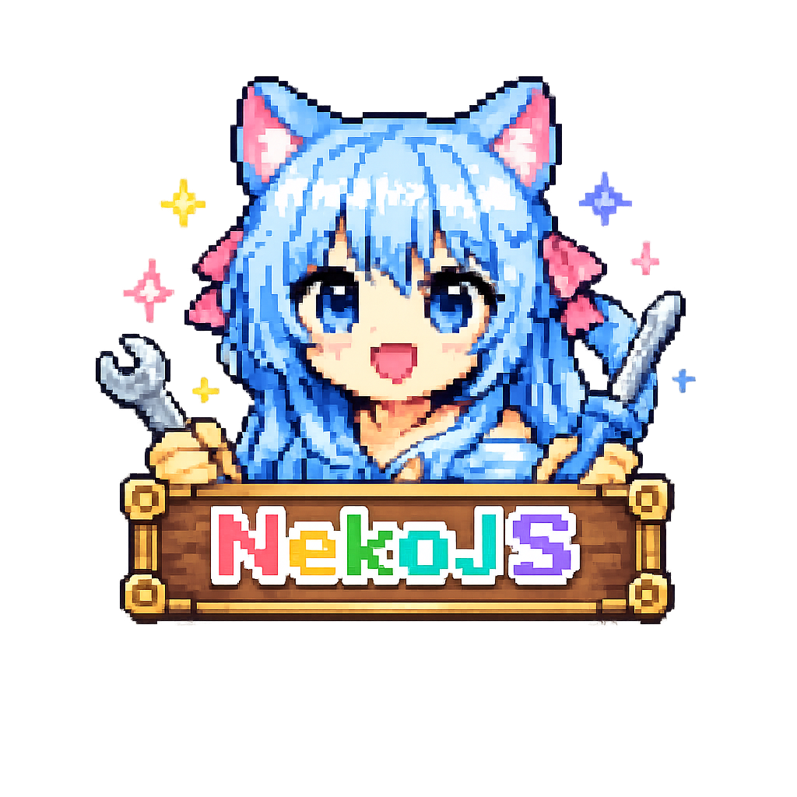

<p align="center">
  
  <br>
  <strong>Skip the hassle of Java mod projects and customize Minecraft with modern JavaScript / TypeScript</strong>
</p>

<div align="center">

[](LICENSE)
[](https://github.com/NekoJS-Dev/NekoJS/actions/workflows/ci-build.yml)
[](https://github.com/NekoJS-Dev/NekoJS/releases)
[](https://www.curseforge.com/minecraft/mc-mods/graal)
[](https://qm.qq.com/q/rbryak0K6k)

[Docs](wiki/home_us.md) · [Quick Start](wiki/quick-start_us.md) · [Download](https://github.com/NekoJS-Dev/NekoJS/releases) · [Issues](https://github.com/NekoJS-Dev/NekoJS/issues) · [中文文档](wiki/home_cn.md)

English | [简体中文](README.zh-CN.md)

</div>

---

## Why NekoJS

If you've used KubeJS or CraftTweaker, here's what you might be looking for:

- **Modern JavaScript:** Runs on GraalJS, with support for the latest ECMAScript syntax, `import` / `export`, top-level `await`, and dynamic `import()`.
- **TypeScript runs directly:** Drop `.ts` or `.tsx` files into a script folder and they run. You don't need to compile or bundle anything yourself.
- **Built-in autocompletion:** Run `/nekojs probe` and NekoJS generates type declarations for the mods you have installed, so VS Code shows you the available events, methods, and item IDs. You don't need to install ProbeJS or a similar mod.
- **npm packages work:** Put a pure-JavaScript npm package in `nekojs/node_modules` and you can `import` it. Common Node.js built-in modules (`fs`, `path`, `events`, and others) are available too.

## What you can do

| What you want to do | Where to write it | Docs |
|---|---|---|
| Add, remove, or replace recipes | `server_scripts` | [Recipe System](wiki/recipe-system_us.md) |
| Add items, blocks, fluids, entities, and creative tabs | `startup_scripts` | [Registering New Content](wiki/registering-new-content_us.md) |
| Run code when a player logs in, a block is broken, an entity takes damage, and more | `server_scripts` | [Event Reference](wiki/event-reference_us.md) |
| Add custom commands | `server_scripts` | [Event Reference](wiki/event-reference_us.md) |
| Draw HUDs and build screens (JSX) | `client_scripts` | [Client Rendering](wiki/client-rendering_us.md), [JSX UI](wiki/jsx-client-ui_us.md) |
| Change the items and descriptions shown in JEI | `client_scripts` | [Event Reference](wiki/event-reference_us.md) |
| Save data and sync it to clients | Any | [Data and State](wiki/data-and-state_us.md) |
| Call Java classes and other mods' APIs | Any | [Module System](wiki/module-system_us.md) |

## Supported versions

| Loader | Minecraft | Java | Status |
|---|---|---|---|
| NeoForge | 1.21.1 | 21 | Supported |
| NeoForge | 26.1.2, 26.2.0 | 25 | Supported, most complete |
| Fabric | 26.1.2, 26.2 | 25 | Supported, some features not yet ported |

Every version requires the [Graal](https://www.curseforge.com/minecraft/mc-mods/graal) library mod: **GraalMC 25.5.0 or later for both Fabric and NeoForge**; use the [loader-specific downloads](wiki/quick-start_us.md#wiki-section-2). For per-platform differences, see [Platform Compatibility](wiki/platform-compatibility_us.md).

## Quick start

**1. Install.** Download the NekoJS build for your Minecraft version and loader from [Releases](https://github.com/NekoJS-Dev/NekoJS/releases), put it in `mods/` together with Graal, and launch the game.

> One NekoJS jar per Minecraft version and loader is used on both client and server; there is no separate `-server` artifact. NekoJS does not bundle ICU4J; the GraalMC 25.5.0 builds for both loaders supply their own relocated ICU.

**2. Find the script folder.** After the first launch, a `nekojs/` folder appears in your game directory:

```text
nekojs/
├── startup_scripts/   Register items, blocks, etc. Changes need a game restart
├── server_scripts/    Recipes, events, commands. Run /nekojs reload after changes
├── client_scripts/    HUDs, key bindings, screens. Run /nekojs reload client after changes
├── test_scripts/      Tests. Only run when you execute /nekojs test
├── assets/  data/     Resource pack and data pack content
└── config/            Configuration files
```

**3. Write a script.** Create `nekojs/server_scripts/welcome.js`:

```javascript
PlayerEvents.loggedIn(event => {
  // The player is event.entity on NeoForge and event.player on Fabric
  const player = event.entity ?? event.player
  player.displayClientMessage(Text.of('Welcome to the server!').gold(), false)
})
```

Run `/nekojs reload`, then rejoin the world to see the welcome message.

**4. Turn on autocompletion.** Run `/nekojs probe` in-game, then open the `nekojs/server_scripts` folder in VS Code.

For the full tutorial, see [Quick Start](wiki/quick-start_us.md). If you run into problems, check the [FAQ](wiki/faq_us.md) first.

## Examples

<details>
<summary><b>Register an item and a creative tab</b></summary>

```javascript
// nekojs/startup_scripts/items.js
RegistryEvents.register(event => {
  event.item('mymod:cool_gem', item => {
    item.maxStackSize = 16
    item.rarity = 'rare'
  })

  event.creativeModeTab('mymod:main', tab => {
    tab.title = 'My Modpack'
    tab.icon = 'mymod:cool_gem'
    tab.add('mymod:cool_gem')
  })
})
```

Takes effect after a game restart. Put the texture at `nekojs/assets/mymod/textures/item/cool_gem.png`.

</details>

<details>
<summary><b>Split code into TypeScript modules</b></summary>

Every file in a script folder gets loaded, so keep only exported functions and constants in `lib/`.


```typescript
// nekojs/server_scripts/lib/ores.ts
export const ORES: string[] = ['minecraft:iron_ore', 'minecraft:gold_ore']

// nekojs/server_scripts/recipes.ts
import { ORES } from './lib/ores.ts'

ServerEvents.recipes(event => {
  for (const ore of ORES) {
    event.remove({ input: ore, type: 'minecraft:smelting' })
  }
})
```

</details>

<details>
<summary><b>Call Java classes</b></summary>

```javascript
import { ArrayList } from 'java:java/util'

const list = new ArrayList()
list.add('hello')
console.info(list.size())
```

Some high-risk Java classes are blocked by default. See [Module System](wiki/module-system_us.md).

</details>

<details>
<summary><b>Write recipes in Python</b></summary>

```python
# nekojs/server_scripts/recipes.py
from nekojs import *

def on_recipes(event):
    event.remove({'output': 'minecraft:stick'})

ServerEvents.recipes(on_recipes)
```

`from nekojs import *` is only there for your editor. Run `/nekojs probe python` to get autocompletion. See [Python Scripts](wiki/python-scripts_us.md).

</details>

<details>
<summary><b>Change what JEI shows</b></summary>

```javascript
// nekojs/client_scripts/jei.js (requires JEI, NeoForge only)
RecipeViewerEvents.removeEntries('item', event => {
  event.add('minecraft:debug_stick')
})

RecipeViewerEvents.addInformation(event => {
  event.add('minecraft:echo_shard', 'Can be used to craft a Recovery Compass.')
})
```

</details>

## Security notice

Scripts are very powerful and can reach most of the game's internals. **Only run scripts written by people you trust.**

By default, NekoJS restricts some dangerous operations: scripts can only read files inside the game directory, can only write files inside `nekojs/`, and can't create threads, use reflection, or access high-risk Java classes such as those for networking and processes. These restrictions are not guaranteed to stop a malicious script. Also, NekoJS does not forcibly interrupt infinite loops, so a buggy loop will freeze the game.

## Building from source

You need JDK 17 or later (25 recommended). Gradle automatically downloads the JDK each Minecraft version needs.

```bash
git clone https://github.com/NekoJS-Dev/NekoJS.git
cd NekoJS
./gradlew :26.1.2:build        # Build one version
./gradlew sandboxCheck         # Full check before submitting
```

Build output goes to `versions/<version>/build/libs/`. For the project layout and other commands, see [Build System](wiki/build-system_us.md) and [Project Architecture](wiki/project-architecture_us.md).

## Contributing

Issues and pull requests are welcome.

- When reporting a problem, please include the logs from `logs/nekojs/`, the script that caused it, and your Minecraft, loader, and NekoJS versions.
- Before opening a PR, read the [PR checklist](.github/PULL_REQUEST_TEMPLATE.md) and the [coding conventions](docs/agents/coding.md).
- Community chat: QQ group **1158525822** ([join](https://qm.qq.com/q/rbryak0K6k))

## License

[LGPL-3.0](LICENSE) © Tki_sor
