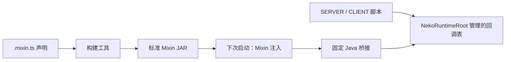

# NekoJS MixinJS 设计方案

日期：2026-11-06。

状态：**设计提案，尚未实现**。本文中的模块、脚本写法、命令和生成物均为拟议契约，不能直接当作当前 NekoJS 功能使用。本文用于维护者审阅，使用中文；未来交付的内嵌手册、API 文档和示例说明使用英文。

调研依据：[MixinJS 一手资料核对](../research/2026-11-06-mixinjs-primary-sources.md)。本轮只写方案，不修改 Mixin 加载器或脚本运行时。

## 1. 推荐方案

让脚本作者用 TS/JS 描述 Minecraft Mixin，由工具生成真正带 `@Mixin`、`@Inject`、`@At` 等注解的 class。生成的 class 通过固定 Java 桥接调用 JS 回调。

推荐把功能分为两个阶段：

1. **启动前准备注入结构。**将独立的 Mixin 声明编译成标准模组 JAR，交给 NeoForge/Fabric 原有的 Mixin 发现流程。作者不需要编写或手工编译 Java。
2. **运行中绑定脚本逻辑。**`server_scripts` 或 `client_scripts` 为已经存在的注入点注册 JS 回调，由 `NekoRuntimeRoot` 管理其 generation、线程、重载和清理。



对作者而言，主要区别是：

| 修改内容 | 拟议操作 |
|---|---|
| 新增注入、修改目标方法、修改 `HEAD/RETURN` 或取消能力 | 重新构建载体，关闭并重新启动游戏 |
| 修改已有注入点的 JS 逻辑 | 对应类型的完整脚本重载；需通过下文的候选切换验证后交付 |
| 暂时停用某个回调 | 移除该回调并重载，原生注入保留为空操作 |
| 从游戏中彻底移除原生注入 | 移除或重建载体并重启 |

首版以 **NeoForge 26.1.2** 为验证节点。26.2.0、1.21.1 和 Fabric 都有独立交付门槛，当前构建通过不代表具有 MixinJS 功能。

这条路线的主要代价是：**第一次使用及每次改变注入结构，都需要一次启动前构建和完整重启。**本方案接受这个代价，以换取正常的类发现流程和清晰的生命周期。

## 2. 为什么普通 startup 脚本不够早

Mixin 的注解存储在 class 文件中，Mixin 使用 ASM 读取并合并这些字节码。相关配置需要在目标类被定义之前准备；`Mixins.addConfiguration` 不能作为通用的已加载类重新织入接口。[Mixin 环境说明](https://github.com/SpongePowered/Mixin/wiki/Introduction-to-Mixins---The-Mixin-Environment)、[MixinInfo 的目标加载检查](https://github.com/SpongePowered/Mixin/blob/4053421aa10aaac6127d969028a29c94fe3054f6/src/main/java/org/spongepowered/asm/mixin/transformer/MixinInfo.java)。

NekoJS 当前在模组入口装配 runtime root、执行 STARTUP 脚本。执行至此时，部分 Minecraft 和其他模组类可能已经加载，不能保证任意目标仍可注入。依据是现有 [NeoForge 入口](../../src/main/java/com/tkisor/nekojs/NekoJSMod.java)、[Fabric 入口](../../src/fabric/java/com/tkisor/nekojs/fabric/NekoJSFabricMod.java) 和 [runtime root](../../common/src/main/java/com/tkisor/nekojs/core/lifecycle/NekoRuntimeRoot.java)。

因此，第一版不在普通脚本重载中补装 Mixin，也不把“本次启动生成了 class”视作“本次启动已经成功应用”。启动前生成的载体在下一次启动进入标准发现流程。

## 3. 如何参考 3093FengMing/mixinjs

参考代码固定到 [`5d23461791d1484404bba2d3ae775174105e35e7`](https://github.com/3093FengMing/mixinjs/commit/5d23461791d1484404bba2d3ae775174105e35e7)，不以随时变化的分支名作为实现依据。

可借鉴其“声明 → 注解 class → Java dispatcher → JS handler”的整体思路，以及针对不同注入器生成不同 handler 的方式。

需要保留差异的地方见调研笔记，主要有：

- 它为读取外部生成的 class/config，使用 CoreMod、ASM、Unsafe 修改 Mixin 内部实现。这不是 `IMixinConfigPlugin.getMixins()` 本身提供的能力，首版不采用这条加载路线。[TransformationService](https://github.com/3093FengMing/mixinjs/blob/5d23461791d1484404bba2d3ae775174105e35e7/src/main/java/me/fengming/mixinjs_coremod/core/MixinJsTransformationService.java)、[外部 class 读取](https://github.com/3093FengMing/mixinjs/blob/5d23461791d1484404bba2d3ae775174105e35e7/src/main/java/me/fengming/mixinjs_coremod/core/MixinInfoInjector.java)。
- 它的静态 Rhino 环境及调用线程直接执行方式，不能替代 NekoJS 的 Graal Context 和 generation 约束。[脚本管理器](https://github.com/3093FengMing/mixinjs/blob/5d23461791d1484404bba2d3ae775174105e35e7/src/main/java/me/fengming/mixinjs/script/MixinScriptManager.java)。
- 它的 reload 没有展示已加载目标类的重新织入，不能据此承诺结构热重载。[重载命令](https://github.com/3093FengMing/mixinjs/blob/5d23461791d1484404bba2d3ae775174105e35e7/src/main/java/me/fengming/mixinjs/commands/MixinJsCommand.java)。
- 仓库已归档，版本、映射及许可范围需要按固定源代码判断。当前只做设计参考；若后续复用源码，先核实其许可要求，详见调研笔记。

## 4. 作者文件放在哪里

推荐的开发工作区布局：

```text
nekojs/
  mixins/
    health.mixin.ts
  server_scripts/
    health-hooks.ts
  client_scripts/
    client-hooks.ts
  generated/
    mixins/
      <profile>/
        plan.json
        targets.json
        generated-types.d.ts
        carrier.jar
```

- `mixins/` 放作者维护的注入声明，支持 `.mixin.js`、`.mixin.ts`。这个目录由声明编译工具读取，不属于普通自动执行脚本目录。
- `server_scripts` / `client_scripts` 放日常运行的回调。源文件位置继续遵循已有工作区和脚本包规则。
- `generated/mixins/` 是工具产物，可以重新构建；不能成为一份需要作者手改的配置源。
- 正式加载的载体安装在该实例的 `mods/` 中；**只在 generated 目录生成 JAR，不会自动使正在运行的游戏应用它**。
- 不新增 `ScriptType.MIXIN`。注入声明是构建输入，运行回调仍属于 SERVER 或 CLIENT。

发行整合包时，可进一步把载体和版本化脚本包合并成一个内容模组 JAR，复用已有 [PackTools.modJar](../../common/src/main/java/com/tkisor/nekojs/core/pack/tool/PackTools.java) 的资源打包及模组元数据路径。现有内容模组生成器尚不生成 Mixin class/config，此处需要扩展，不能直接宣布已可复用。

首版先交付松散工作区；内容模组发行形态放在后续阶段。打包在 JAR 内的脚本仍遵循已有包来源、缓存及更新规则，不承诺编辑任意 JAR 后可直接热重载。

## 5. 拟议脚本写法

### 5.1 注入声明

以下只展示接口设计。目标方法在具体节点是否存在、名称是否正确，必须由构建工具用该节点的目标字节码验证。

```ts
import { Mixin } from "nekojs/mixin";

Mixin.target("net.minecraft.world.entity.LivingEntity", target => {
    target.inject("getMaxHealth()F", "demo:max_health", build => {
        build.at = "RETURN";
        build.cancellable = true;
        build.scriptType = "SERVER";
        build.thread = "SERVER_MAIN";
        build.require = 1;
    });
});
```

`Mixin` 是声明工具导出的助手；配置回调放最后，使用 Bean 属性表达配置。工具执行结果为不可变声明，不保存这些构建闭包。

`demo:max_health` 是作者可读的稳定 hook ID。目标方法必须包含 JVM descriptor，避免重载方法仅靠名字误匹配。后续可提供选取助手，但最终计划必须解析为唯一的类、方法名和 descriptor。

### 5.2 游戏中的回调

```ts
MixinEvents.inject("demo:max_health", event => {
    event.returnValue = Math.max(event.returnValue, 40);
});
```

这个例子放在 SERVER 脚本中。`event.self` 根据目标推导为 LivingEntity，`event.args` 是空参数元组，`event.returnValue` 是 `number`。它用于说明返回值语义，不是对高频属性查询性能的承诺。

CLIENT hook 在 CLIENT 脚本注册，并声明 `CLIENT_MAIN`。这里继续使用项目已有的 Event Group 订阅风格；没有 `globalThis` 预注入声明构建助手的要求。

### 5.3 对注解的映射

| 脚本声明 | 生成的 Mixin 语义 |
|---|---|
| `Mixin.target(className, ...)` | `@Mixin(targets = ...)` |
| `target.inject(method, id, ...)` | 目标方法上的 `@Inject` handler |
| `build.at = "HEAD" / "RETURN"` | `@At("HEAD")` / `@At("RETURN")` |
| `build.cancellable` | `@Inject(cancellable = ...)` |
| `build.require` | `@Inject(require = ...)` |
| 目标的物理环境 | Mixin 配置的 `mixins` / `client` / `server` 分组 |
| `build.scriptType`、`build.thread` | NekoJS 回调路由和线程要求，不是伪造的 Mixin 注解字段 |

声明层表达与原生注解一一对应的有限能力，未知字段或暂不支持的注入器直接拒绝。

## 6. 声明编译与载体构建

建议扩展现有 pack 工具的命令入口，提供 `mixin validate`、`mixin build`、`mixin inspect`；这些命令名尚未实现。

构建顺序：

1. 读取声明及明确的 node/profile，处理本地声明模块依赖。
2. 使用现有 TypeScript 擦除及模块准备能力，在**独立工具进程**的受限声明环境求值，收集不可变计划。
3. 声明工具只暴露 Mixin builder、确定性的配置数据和受限相对导入，不安装 Minecraft Binding、普通脚本事件或游戏 runtime root。不能通过执行整份 `startup_scripts` 来提取声明。
4. 根据目标字节码和映射资料，验证方法身份、静态性、参数、返回值及注入限制；读取 class 字节，不执行 `Class.forName` 初始化目标。
5. 生成带注解的 Mixin class、配置、必要的映射资料、来源映射和载体清单。
6. 生成该 loader 的标准模组元数据、校验依赖和产物完整性。
7. 暂存并验证 JAR，成功后再发布。安装过程只替换能证明属于本工具的旧产物，保留来源和摘要，不借覆盖安装删除其他模组。

声明环境复用现有编译器不代表现有编译器已经支持这个构建目标。工具进程的 Context 归编译任务所有，任务结束即关闭；游戏进程内仍只有 `NekoRuntimeRoot` 负责运行脚本。

载体至少包含：

```text
META-INF/neoforge.mods.toml OR fabric.mod.json
nekojs-mixin-<carrier-id>.mixins.json
nekojs/mixin-plan.json
nekojs/mixin-sources.json
<dedicated-generated-mixin-package>/*.class
<refmap-or-verified-runtime-name-data>
```

Mixin class 所在包只放 Mixin，普通桥接类放其他包，遵守 Mixin 对其专用包的类加载限制。[Mixin 环境说明](https://github.com/SpongePowered/Mixin/wiki/Introduction-to-Mixins---The-Mixin-Environment)。

NeoForge 与 Fabric 通过各自标准元数据发现 Mixin 配置。[NeoForge Mixin 配置](https://docs.neoforged.net/docs/gettingstarted/modfiles/#mixin-configuration-properties)、[Fabric 模组元数据](https://docs.fabricmc.net/develop/getting-started/project-structure#fabricmodjson)。第一版不依赖启动中临时修改 loader classpath，也不修改 Sponge 内部类。

## 7. 稳定身份、映射和启动校验

每条声明必须区分：

- **hook ID**：作者稳定引用的名字，例如 `demo:max_health`。
- **结构身份**：载体 ID、目标类、方法名及完整 descriptor、注入位置、取消能力、物理环境等。
- **结构摘要**：规范化结构计划、生成器 ABI、node/profile 和映射资料的摘要。
- **运行回调身份**：hook ID、脚本来源、ScriptType 和 generation。

JS 函数体不进入结构摘要；改变 `at`、descriptor 或取消能力必须改变结构摘要。不能靠“方法名 + HEAD”拼接内部 key，同名方法、不同类及多个声明必须可区分。

产物绑定 MC 版本、loader、Mixin/桥接 ABI、目标命名环境和所需模组依赖。开发环境名称、Probe 显示名称和生产环境名称必须分别核对。尤其不能把历史 Fabric intermediary 规则机械套到每个 26.x 节点。[Fabric 映射说明](https://wiki.fabricmc.net/tutorial:mappings)。

生成 class 的版本必须同时满足目标节点的 Java、ASM/Mixin 和配置兼容级别。ASM 的直接依赖及打包归属在原型时明确，不能依赖开发环境偶然提供的传递依赖。

映射实现是 P0 的阻断项：采用已验证的 remap/refmap 路径，或为明确运行命名环境生成专用产物。**在开发客户端可用，不足以证明发布 JAR 可用。**不提供“全部 `remap = false`”作为通用捷径。

建议默认 `require = 1` 并禁止仅靠方法名的模糊选择。`RETURN` 可能匹配多个返回指令，多个匹配并不自动构成错误。`expect`、`allow` 等更细的数量控制在实际内嵌版本验证后再开放。[Inject 语义](https://github.com/SpongePowered/Mixin/wiki/Advanced-Mixin-Usage---Callback-Injectors)。

## 8. 原生桥接如何工作

生成的 handler 保留原生目标需要的精确 Java 签名。其内部只做以下事情：

1. 记录进入注入点时的参数和已有返回值。
2. 用固定载体/slot 身份向 Java 桥接请求本次处理决定。
3. 决定验证通过后，才修改 `CallbackInfo` / `CallbackInfoReturnable`。

HEAD 的未就绪或失败路径继续原方法；RETURN 的未就绪或失败路径保留当时的返回值。不得通过反射再调用一次目标方法来“补偿”，否则会重复原方法的副作用。

桥接的早期调用入口只依赖 JDK 类型和一个可为空的调度句柄。没有 runtime 或回调时立即返回；不在目标方法调用中懒创建 Graal Engine、Context 或 `NekoRuntimeRoot`，也不初始化 Minecraft 单例。

原生注入可以早于 NekoJS 运行时就绪，因此首版面向**脚本加载完成后的游戏行为**。若要求修改 NekoJS 启动前已经发生的静态初始化或其他模组构造行为，需要另外设计原生启动逻辑，不能承诺 JS 回调可以倒流执行。

## 9. 同步返回、取消和异常

首版遵循下列可测试语义：

| 注入情况 | 脚本操作及结果 |
|---|---|
| HEAD，void，可取消 | `event.cancel()` 阻止原方法继续执行 |
| HEAD，非 void，可取消 | 设置 `event.returnValue`，提供结果并跳过原方法 |
| RETURN，非 void，可取消 | 初值为原方法结果，设置 `returnValue` 替换结果 |
| 观察型注入 | 只能读取；修改控制状态报错 |
| 非 void HEAD | 单独 `cancel()` 被拒绝，必须明确提供返回值 |
| 原方法抛异常 | 普通 RETURN hook 不执行；首版不提供 finally/异常注入 |

原生 `CallbackInfoReturnable.setReturnValue` 会触发取消。脚本层必须保留这个含义，避免把“修改返回值”误写成一个只修改 JS 临时字段的操作。[CallbackInfoReturnable](https://github.com/SpongePowered/Mixin/blob/4053421aa10aaac6127d969028a29c94fe3054f6/src/main/java/org/spongepowered/asm/mixin/injection/callback/CallbackInfoReturnable.java)。

每次回调使用独立的暂存控制状态：回调正常结束且返回值通过类型检查后，才应用取消/替换决定。回调抛错、返回类型错误或返回 Promise 时丢弃该回调的控制决定，并报告原始脚本位置。Java VM 终止类错误不纳入普通脚本错误恢复。

回调要求同步返回 `undefined`；用事件属性和方法表达控制，不使用 `return false`、`return 40` 这样的隐式协议。拟议类型为 `(event: E) => undefined`，配合实际执行结果检查，避免 `=> void` 在 TypeScript 中仍允许 async 函数的问题。

`event` 的取消和返回值控制只在当前回调期间有效，回调结束后再次使用会被拒绝。脚本保存的 `self` 或其他 Java 对象仍遵循现有访问规则；本设计不承诺撤销脚本已经执行的世界、文件或任意 Java 副作用。

## 10. 线程与重入

GraalJS 的共享 Context 不能被多个线程同时执行；NekoJS 还需要遵守游戏对象所属线程。[GraalJS 多线程说明](https://www.graalvm.org/latest/reference-manual/js/Multithreading/)。

第一版只开放显式声明为 `SERVER_MAIN` 或 `CLIENT_MAIN` 的 hook：

- 由平台 Adapter 校验实际调用线程，再进入对应 manager 的受管回调入口，保留脚本 ID、generation、资源限制和回调深度记录。
- 线程不符合时，不进入 JS，使用原方法/原返回值，按 hook 限频报告诊断。不把“加锁后允许任意调用线程”当作游戏线程安全。
- 不把返回值 hook 异步排队后继续返回，也不让工作线程阻塞等待主线程决定，以免破坏同步语义或死锁。
- `SERVER` 表示逻辑服务端，包含单人游戏内置服务端；Mixin 配置的 `server` 分组表示物理专用服务端。这两者要分别建模。
- 同一个 slot 在同一线程重入时跳过本次 JS 分发，执行原方法；不同 slot 可以嵌套，环形调用最终在已活动 slot 处截断。
- JS 回调内部请求重载，继续遵循现有 reentrant reload 拒绝规则。

构建工具无法普遍静态证明任意方法只在主线程调用，运行时线程校验仍是必需。对异步 I/O、并行世界任务、工作线程渲染等目标，首版明确不承诺 JS 注入逻辑可执行。

## 11. 运行时所有权与回调重载

`NekoRuntimeRoot` 拥有 Mixin hook 的调度资源及其注册租约；SERVER/CLIENT generation 拥有各自 JS 回调。注入后的 Java 指令属于本次 JVM 生命周期。

生成类通过固定桥接访问不暴露 root 的调度句柄。桥接不提供全局 `getRoot()`。句柄在平台装配完成后绑定；root 关闭时以租约身份解绑，旧 root 的迟到关闭不能清除新 root 的绑定。

同一个载体在一个进程中只能绑定一个有效生产调度租约；测试 root 必须隔离或显式释放，不能静默抢占生产句柄。

回调重载的拟议过程：

1. 候选脚本注册回调，只写候选状态，校验 hook 是否存在、来源是否允许、ScriptType 和结构摘要是否匹配。
2. 同一个 hook ID 在一个活动脚本类型中只允许一个回调，重复注册使候选失败。第一版不引入多回调的取消竞争协议。
3. 候选计划预检全部通过后，在现有 owner-thread commit 中发布回调表。
4. 候选失败保留旧表；成功后使旧 generation 回调失效，并释放其 JS 引用。
5. 移除回调生成空槽，class 中的注入继续存在，但其行为回到原方法。
6. root 关闭、对应世界的 SERVER manager 释放或 CLIENT generation 关闭后，迟到调用不复活旧 Context。

候选求值或计划预检自身调用被注入的方法时，应跳过 JS hook，走原生行为，避免把候选运行意外投递给生产回调。需要把这个执行来源检查纳入测试，不能仅检查“候选监听器还没发布”。

复用现有 [CandidateDomainCollector](../../common/src/main/java/com/tkisor/nekojs/core/lifecycle/CandidateDomainCollector.java)、[CandidateStatePlan](../../common/src/main/java/com/tkisor/nekojs/core/state/CandidateStatePlan.java) 及事件 generation 计划。现有 `Handle.listenersOf` 明确不支持带 dispatch key 的总线，因此不能直接用它扫描 `MixinEvents.inject(id, ...)`。实施时应在现有事件计划上提供所需的 key-aware 计划校验/索引接缝，或由域 owner 收集其候选注册；不得忽略 key 全量派发，也不得另建一套生产脚本 runtime。

## 12. 多个 Mixin 与失败边界

一个 JS hook 只有一个活动回调，不等于一个目标方法只能有一个 Mixin。不同声明、不同包以及第三方模组仍可能修改同一方法。

第一版：

- 保留标准 Mixin 的 priority 和应用顺序规则；对同一包内重复的可修改注入位置进行检查并要求作者合并意图。
- 不宣称可以自动协调所有模组的返回值或取消冲突；后续提供 inspect 输出实际目标和应用记录。
- 结构错误、目标不存在、要求的匹配数未满足时，采用明确的构建/启动失败，而非假装 hook 成功。
- 构建预检不能取代运行时 Mixin 检查：其他转换器可能改变最终匹配位置。
- class 转换中途失败不属于 JS generation 事务，不能承诺保留上次进程的字节码；启动失败需要修复产物并重启。

普通运行回调异常的恢复只覆盖本次回调的暂存控制决定。错误应进入现有 ErrorTracker/报错 UI，并附 carrier、hook、目标、ScriptType、generation 和脚本位置，不在高频目标中逐次刷屏。

## 13. 首版能力范围

| 能力 | 推荐阶段 |
|---|---|
| 精确目标类和完整方法 descriptor | 首版必需 |
| 普通方法的 `@Inject HEAD / RETURN` | 首版 |
| 实例、静态方法的参数读取及 receiver 读取 | 首版，静态方法的 `self` 为 `undefined` |
| 取消、同步修改返回值 | 首版，受线程与类型约束 |
| void、boolean、byte/short/int、float/double、char、引用与数组 | 首版目标范围，逐类型证明后开放 |
| long 参数或返回值 | 先证明 bigint 无损 ABI；未通过时整个对应目标拒绝，不降级成不精确 number |
| `<init>`、`<clinit>` | 首版排除 |
| INVOKE、FIELD、slice、ordinal、shift、局部变量捕获 | 后续独立能力，不先暴露空壳字段 |
| Accessor / Invoker / Shadow / Unique | 后续；需额外设计访问、持有对象和字段生命周期 |
| ModifyArg / ModifyVariable / ModifyConstant | 后续 |
| MixinExtras WrapOperation / ModifyReturnValue 等 | 在明确需求出现时单独验证 |
| Redirect / Overwrite | 首版排除，先评估更容易组合的替代方式 |
| 运行中添加、删除、改写已加载类的注入结构 | 不纳入本方案 |
| 在 Mixin 应用或目标静态初始化时执行用户 JS | 首版排除 |

`char` 的 JS 投影为单个 UTF-16 code unit 的 string；整型必须在范围内且不能带小数。引用和数组使用既有 Java 值转换规则，并在应用返回决定前检查兼容性。float/double 的特殊值、溢出及精度规则必须形成明确契约和负例，不能依赖偶然的强制转换。

构造器具有未初始化 `this` 等额外限制，现代内嵌 Mixin 与旧 wiki 的规则也需要区分；不以“只加一个 RETURN 选项”处理。[CallbackInjector](https://github.com/SpongePowered/Mixin/blob/4053421aa10aaac6127d969028a29c94fe3054f6/src/main/java/org/spongepowered/asm/mixin/injection/callback/CallbackInjector.java)。后续包装原调用时，可评估 MixinExtras 的组合语义，但不能由其能力推导出 JS continuation 已安全。[WrapOperation](https://github.com/LlamaLad7/MixinExtras/wiki/WrapOperation)。

## 14. Probe 与作者支持

补全必须来自**已验证的目标计划和实际节点类型**，不让每个作者手写声明或把 callback 简化为 `Function`。

生成器按 hook ID 产生 `MixinEvents.inject` 的类型化重载，包含：

- `self` 的具体 Java 类型，静态方法为 `undefined`。
- 只读 `args` 参数元组，保留顺序和每个参数类型。
- RETURN 的初始返回值类型，以及是否允许修改。
- HEAD 的取消/提供返回值能力；观察型事件不暴露可写控制字段。
- `void`、primitive、引用可空性及 long/bigint 的明确投影。

声明工具的 `nekojs/mixin` 导出独立构建类型；普通脚本端的事件声明走现有 catalog、Probe 和类型消费者流程。生成的静态类型不替代运行时按 ID、ABI、来源和返回值类型检查。

运行中的 hook catalog 和 Probe 以**本次启动已加载载体的计划**为准。离线新构建的声明属于待安装产物，不直接覆盖正在运行实例的 hook 类型。源声明或候选绑定与已加载结构不匹配时，应拒绝新绑定并提示重建/重启，保留健康旧代。

诊断还需区分“JAR 已生成”“配置已加载”“目标已应用”“回调已绑定”。目标可能尚未加载，不能把载体存在当作注入成功；没有可靠应用记录时明确报告未知。若使用标准配置插件记录应用结果，只采集早期安全元数据，不在其中执行 JS。

来源映射应支持从 hook ID 跳转到 `.mixin.ts` 和运行 handler 文件。初次构建前仍应能补全 builder；具体目标类型补全在计划验证后生成。

错误区分为：声明错误、目标解析错误、映射错误、Mixin 应用错误、ABI/计划不匹配、回调绑定错误、运行回调错误。沿用现有诊断链路；新增稳定 `NEKO-` 编号在实现时核对空号并同步双语错误参考，本提案不提前占号。

## 15. 安装来源与包规则

Mixin 载体会修改原生执行路径，第一版限定为本地作者构建并安装的内容。普通服务端脚本包同步不自动生成、安装或修改客户端载体。

hook ID 与声明来源绑定。首版不允许远端同步脚本仅凭相同字符串 ID 绑定本地 hook，也不把远端缓存目录重新解释成本地可信来源。继续使用已有 [NekoRuntimeTrustContext](../../common/src/main/java/com/tkisor/nekojs/core/module/NekoRuntimeTrustContext.java) 的来源记录。

运行中的声明文件变化只产生“需要重新构建并重启”的状态；不会在某些类已经加载后偷偷替换实际计划。缓存摘要用于判断产物是否匹配，不能代替安装授权或代码来源。

## 16. 实现落位

保持少量负责完整行为的 Module，不为每个注解字段建立一层包装。

| Module | Interface 与职责 | 建议归属 |
|---|---|---|
| 声明编译 Module | TS/JS 声明与目标资料 → 已验证不可变计划、来源和类型数据 | `common`，不依赖 Minecraft/loader |
| 载体生成 Module | 计划及 node profile → 可验证的注解 class、配置、映射资料与 JAR | 纯数据/字节码部分可在 common；loader 元数据与真实节点差异经版本层 Adapter |
| hook 运行 Module | 固定 slot 的同步调用 → 已验证控制决定；拥有回调计划、重入和生命周期 | common 的 root-owned 引擎实现；公开事件契约按需要放 `api.*` |
| 平台 Adapter | 模组发现、目标资料/映射、物理环境、线程判断、早期桥接可见性 | 版本树；NeoForge 与 Fabric 分别验证 |

使用现有 root 资源跟踪、事件组、Binding/类型文档注册和包工具。首版只有内置注入器，不为假想的第三方注入器新增公共扩展点；若后续确有插件集合需求，再按 Point / Plugin Hook / Contributor 模型增加配对契约。

当前 `nekojs-dynamic.mixins.json` 属于已有运行时内容注册的固定 Java Mixin，不能因名称包含 dynamic 就当作 MixinJS 加载设施。`common` 零 Minecraft/loader 依赖及单一 runtime owner 约束继续遵守 [模块边界 ADR](../adr/0007-module-boundaries.md)。

## 17. 备选路线比较

| 路线 | 收益 | 成本／决定 |
|---|---|---|
| 标准载体 JAR + 现有运行时回调 | 使用 loader 的正式配置发现；易核对产物、映射与重启边界 | **推荐**；需要启动前构建和安装 |
| 极早启动 JS，现场生成并注册 Mixin | 作者表面上只需放脚本再启动 | 每个 loader 都要证明字节码可见性、Graal 初始化和时序；作为后续可行性研究 |
| 复制参考项目修改 Mixin 内部类 | 能读取外部生成 class | 内部实现、Unsafe、加载器/JDK 版本耦合高，不作为默认实现 |
| 普通 STARTUP 回调中补注册任意目标 | 接近现有脚本体验 | 无法保证目标未加载，不作为正式契约 |
| 预先写好有限 Java Mixin，再给 JS 暴露事件 | 适合稳定业务事件、交付成本低 | 可用于已有事件体系；无法覆盖作者指定的新目标方法 |

未来若希望“放入声明后启动即可”，优先考虑在启动器/开发启动任务中自动执行同一个载体编译步骤。这样可以改善操作体验，而不改变目标类必须及时准备的规则。

## 18. 分阶段实施与验收

### P0：证明最难的接缝

先做有限实验，不一次实现全部 DSL：

1. 在 NeoForge 26.1.2 构建一个标准载体，确认 Mixin 配置和生成 class 经正常发现应用。
2. 用隔离测试类验证 HEAD、RETURN、void/非 void、静态/实例、重载 descriptor、多个 RETURN，以及 double 双槽参数；读取层级资料时不提前加载目标类。
3. 验证早于 root 就绪的调用走原方法，运行时绑定后才调用 handler，关闭后再次恢复原生路径。
4. 同一结构分别在开发启动和正常安装的发布客户端验证名称解析与映射；补专用服务端实验。
5. 验证 Graal callback、线程错误、同步取消、异常后保留原返回值，以及 JS Promise 拒绝。
6. 运行脚本本身调用被注入方法，验证同 slot 重入、候选执行隔离与无死锁。

若标准载体发现、桥接类可见性或生产映射尚未通过，停在实验阶段，不承诺可用功能。

### P1：最小可交付功能

- 声明 builder、校验/构建/inspect 工具、工作区安装流程。
- HEAD/RETURN 的有限首版能力、明确的 unsupported 诊断。
- SERVER/CLIENT 回调、类型化 Probe、错误定位。
- 已有 slot 的完整类型候选重载：成功替换、失败保留、移除、关闭与迟到调用。
- 活动回调表为空时，在创建事件、装箱参数数组或进入 Graal 前快速退出。
- 对无载体、存在空槽、启用空回调、修改返回值四种情况分别测量开销和分配。给出测量环境、基线和维护者认可的预算，不先写“零开销”。
- 英文内嵌手册、可执行示例、双语 wiki、CLI/Probe 帮助及完整状态说明。

### P2：扩展与移植

- 按节点验证 NeoForge 26.2.0、1.21.1、Fabric 26.1.2/26.2.0。
- 内容模组一体化打包、optional mod 条件、更多注入器和 MixinExtras。
- 依实际性能数据决定是否增加 Java 原生表达式路径；不要求脚本作者自行写缓存绕过普遍的分发开销。
- 自动启动前构建作为体验改进，沿用同一计划和载体格式。

### 验证矩阵

| 层面 | 必须区分的用例 |
|---|---|
| 编译 | 无效 descriptor、同名重载、缺失类、重复 ID、不支持类型、非法取消组合 |
| 字节码 | annotation 成员/retention、静态性、所有开放的返回类型、参数槽位、栈帧、桥接 ABI |
| 加载 | 标准发现、类可见性、已有目标加载错误、开发/生产映射、无 NekoJS 的依赖拒绝 |
| 运行 | 无回调、正常回调、取消、替换、类型错误、异常、过期 event、Promise、重入、非 owner thread |
| 重载 | 候选不发布、成功切换、失败保留、空表移除、候选间接调用目标、旧代释放、world/root 关闭 |
| 类型 | builder 补全、hook ID、self/args/返回值、静态 self、只读控制、错误返回与 async 负例 |
| 平台 | 每个 node 独立的真实生产客户端／服务端 smoke；不以 JVM fixture 代替实机 |

按仓库规则执行 `:common:check`、guardLint、受影响 node build/platform gate、Probe 类型消费者及 source-root/CI gate。实机验收分别记录节点、构建、操作、日志和维护者结论。

## 19. 本轮结论与尚未证明的内容

本轮已完成参考源码及官方资料核对、NekoJS 启动/重载/包/类型生成接缝检查，并提出上述推荐路线。

本轮**未实现** builder、载体生成器、hook runtime 或命令；未执行动态字节码、MixinJS 游戏实验或性能测试。各节点实际内嵌 Mixin 版本的细节、映射路径、早期桥接类可见性以及已有事件计划的 key-aware 接线，仍须由 P0/P1 证明。

当前仓库的 ItemJS 注释提到过往早期 Mixin 注入启动异常。本轮记忆检索未找到对应实验记录，未复现该问题，因此只把它作为回归线索，不推广成对现代 Mixin 能力的普遍结论。

建议先接受“标准载体、结构重启、固定 slot 回调重载”的方向，再实施 P0。若产品要求第一次放入脚本就必须在同一次启动完成任意注入，则应单独把极早发现及字节码供应方案作为目标重新论证。

## 20. 本文验证

- 已检查本方案、调研笔记及上一个目标验收记录的本地链接和代码围栏。
- 已用仓库 TypeScript 5.8.3 验证 `(event: E) => undefined` 的最小协议：正常同步 block 回调通过，async 和返回 number 的负例被拒绝。该检查不代表拟议的 MixinEvents 已实现。
- 一手资料调研作者对本方案的加载、注入、映射、许可及重载事实进行了交叉核对，未提出实质性事实修正。
- 本轮为文档变更，未重新运行 NekoJS 构建、游戏或字节码实验；P0/P1 验收仍未执行。
