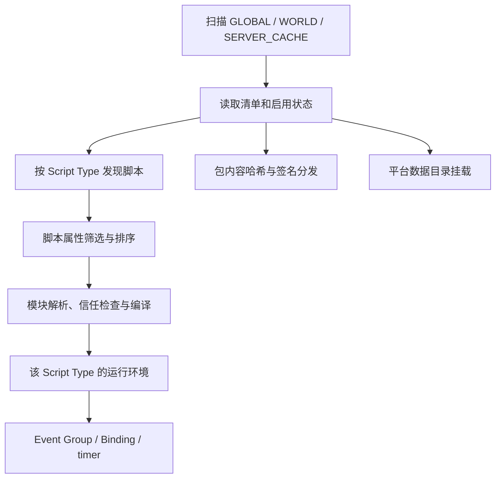

# NekoJS 脚本包机制整理与改进选项

日期：2026-10-13。源码基点：`fe89c770d2d47efe1d3f72421328565eaf7dd889`；其中最新生产源码提交为 `f236a983b915023283b2baf200ddec4074844712`。

本轮根据维护者要求，由 Luna xhigh 子代理调查源码，主代理交叉核对作者入口并整理。维护者选择“先全面整理，再选修改范围”。本文供选择修改范围，不代表批准某个新接口或已经实现建议功能。本轮只新增研究文档，不修改代码、配置、生成声明或既有设计。

详细实现依据见 [源码调研](2026-10-13-script-pack-mechanism-source.md)。以下链接的 `#L` 标记用于定位当前基点的源码行。

## 1. 现在的脚本包是什么

当前脚本包是带 `manifest.json` 的目录，集中放置不同 Script Type 的脚本及相关内容。它已经有包身份、来源、启用状态和远端验证分发；还不能仅凭一个包目录，就推导出独立 Context、独立权限、动态依赖或原子局部替换。

| 容易混淆的概念 | 当前含义 |
|---|---|
| 脚本包 | `manifest.json` 加四类脚本目录，可附带 `assets/`、`data/` |
| ESM / CJS 模块 | 一个文件的导入、导出、缓存与代码依赖关系 |
| Minecraft 资源包 / 数据包 | 由平台资源系统挂载的资源内容；脚本包包含目录不等于全部平台自动挂载 |
| Java 插件 | 通过现有 Plugin Hook / Extension Point 提供引擎能力，普通脚本重载不重新 bootstrap |
| 受管运行单元 | 既有改进方案提出的独立激活、停止、替换单位；不能写成当前所有脚本包已经具备的行为 |

依据：[ScriptPack](../../common/src/main/java/com/tkisor/nekojs/core/pack/ScriptPack.java#L11)、[内容范围](../../common/src/main/java/com/tkisor/nekojs/core/pack/sync/PackHasher.java#L28)、[数据挂载边界](../../src/main/java/com/tkisor/nekojs/resource/ScriptPackDataManager.java#L33)、[既有设计的术语](cordis-v4-reassessment.md#3-先统一实现中的几个概念)。

## 2. 作者目前怎样组织与运行

```text
nekojs/
├── startup_scripts/                  平铺启动脚本
├── server_scripts/                   平铺服务端脚本
├── client_scripts/                   平铺客户端脚本
├── test_scripts/                     平铺测试脚本
├── node_modules/                     共用外部 JS 模块位置
├── packs/<目录名>/                   GLOBAL 包
│   ├── manifest.json
│   ├── startup_scripts/
│   ├── server_scripts/
│   ├── client_scripts/
│   ├── test_scripts/
│   ├── assets/
│   └── data/
└── server_packs/<服务器桶>/           SERVER_CACHE，已接收包

<存档>/nekojs_packs/<目录名>/          WORLD 包，结构与 GLOBAL 相同
```

这是布局说明，实际目录名与 manifest 的 `id` 不必相同。只扫描包根目录的直接子目录；缺少 manifest 不被识别为包。清单解析在缺失或空 `id` 时使用清洗后的目录名；注册扫描还会清洗显式 `id` 并报告变化。因此有效包 ID 与清单原始字符串可能不同，同来源重复 ID 会跳过后发现的包。[manifest 解析](../../common/src/main/java/com/tkisor/nekojs/core/pack/ScriptPackManifest.java#L32)、[目录扫描与 ID 清洗](../../common/src/main/java/com/tkisor/nekojs/core/pack/ScriptPackRegistry.java#L168)。

当前可识别的最小清单示例：

```json
{
  "id": "example_pack",
  "name": "示例包",
  "version": "1.0.0",
  "enabled": true,
  "clientSync": true
}
```

这个例子没有 `entry`、`dependencies`、`permissions` 等拟议字段。当前模型明确读取的字段是 `id`、`name`、`version`、`description`、`authors`、`enabled`、`clientSync`、`signature`、`config`；未知键保留在 raw JSON 中，保留不等于拥有对应运行语义。`version` 是字符串元数据，不能当作已经实施语义版本依赖约束。[清单模型与默认值](../../common/src/main/java/com/tkisor/nekojs/core/pack/ScriptPackManifest.java#L17)。

发现顺序为 GLOBAL → WORLD → SERVER_CACHE → 平铺目录，各来源内包按 ID 排序、脚本按路径排序。随后脚本级 `priority` 与 `after` 会再次排序，所以“包先于平铺”是发现顺序，不是高优先级平铺脚本永远不能先运行的保证。`after` 只在相同 priority 且双方会执行时形成排序边；它不是包版本依赖，也不会等待某个提供者可用。[来源顺序](../../common/src/main/java/com/tkisor/nekojs/core/pack/ScriptPackRegistry.java#L45)、[脚本发现](../../common/src/main/java/com/tkisor/nekojs/core/ScriptLocator.java#L44)、[排序规则](../../common/src/main/java/com/tkisor/nekojs/script/ScriptLoadOrderSorter.java#L17)。

脚本目录内支持的文件递归发现为入口，没有基于 manifest 的入口清单。文件仍可被脚本级 `disable`、`modloaded` 或预读失败排除。对于“只想作为库被 import 的文件”，需要明确当前扫描与入口执行的区别，不能把文件放进脚本目录就假定它不会被单独执行。[扫描](../../common/src/main/java/com/tkisor/nekojs/core/ScriptLocator.java#L99)、[执行筛选](../../common/src/main/java/com/tkisor/nekojs/script/ScriptContainer.java#L53)、[执行入口](../../common/src/main/java/com/tkisor/nekojs/script/ScriptManager.java#L690)。

## 3. 当前各层职责



这张图表示职责关系，不表示每条分支在同一事务中一起提交。包发现由 `ScriptPackRegistry` 负责，脚本归属由 `ScriptLocator` / `ScriptContainer` 记录，生命周期由 `NekoRuntimeRoot` 与各 Script Type 的 `ScriptManager` 负责。来源 scope 与独立世界/会话实例作用域是不同概念。[root 所有权](../../common/src/main/java/com/tkisor/nekojs/core/lifecycle/NekoRuntimeRoot.java#L27)、[归属元数据](../../common/src/main/java/com/tkisor/nekojs/script/ScriptContainer.java#L25)。

| 层次 | 当前有的能力 | 尚不能推导出的能力 |
|---|---|---|
| 包发现与身份 | 三种来源、包 ID、版本、启用状态 | 完整安装器、包版本求解器、任意实例作用域 |
| 文件模块 | 相对导入、内置/Java 模块、共享 node_modules 查找、依赖失效 | 以包 ID 为命名空间的公开导出与依赖锁定 |
| 运行环境 | 按 Script Type 的环境及受管状态 | 每个包自动获得独立 Context/global/沙箱 |
| 整类重载 | 候选准备与交接，限定范围内失败保留 active | 任意外部文件、Java、世界副作用都能回滚 |
| 单文件重载 | 失效模块并重跑受影响入口，清理监听和 timer | 独立运行单元集合的原子候选替换 |
| 包同步 | 哈希、bundle、验证、缓存、运行时接入 | 自动等价于动态注册表 PREPARE/ACK/COMMIT |

模块与重载的逐项调用链、测试定位见 [源码调研](2026-10-13-script-pack-mechanism-source.md)。

## 4. 重载、卸载和“隔离”需要讲清楚

整类 SERVER / CLIENT 重载与单文件重载不是同一失败契约。当前单文件路径在 active Context 中失效缓存、逐个清理并重跑受影响入口；中途失败会继续清理未重跑入口，需要再次重载恢复。不能把它描述为“一个包更新失败，整个旧包及其依赖者都原封不动保留”。STARTUP 文件请求退化为完整 STARTUP 重载，注册行为仍有不可逆边界。[单文件重载](../../common/src/main/java/com/tkisor/nekojs/script/ScriptManager.java#L1257)。

世界包卸载有明确的脚本 ID 前缀清理，取消其监听器和 timer；这条路径不会因此关闭整个共用 Context。这个范围不能扩写成任意文件句柄、第三方线程、Java 对象或所有共享状态都自动回收。[世界包清理](../../common/src/main/java/com/tkisor/nekojs/script/ScriptManager.java#L605)。

`global` 是同一 Script Type 的受管共享状态，另有显式跨类型共享状态。包 ID 提供归属与定位，并不自动建立包私有 global。未来如果引入包级状态，必须决定既有共享数据如何继续访问、是否迁移及谁负责清理。[状态所有权](../../common/src/main/java/com/tkisor/nekojs/core/lifecycle/NekoRuntimeRoot.java#L59)、[已有约束](../agents/coding.md#resources-threads-and-state)。

## 5. 分发、信任与资源目录是三件事

包内容哈希/分发范围是 manifest 加四类脚本目录、`assets/`、`data/`；根级状态文件不属于分发内容，`node_modules` 被过滤。签名输入带 sync ID、来源 scope 与去掉 signature 的规范化 manifest，不能改成“复制到任意来源仍可用”的保证。[哈希范围](../../common/src/main/java/com/tkisor/nekojs/core/pack/sync/PackHasher.java#L17)、[签名负载](../../common/src/main/java/com/tkisor/nekojs/core/pack/sync/PackSignaturePayload.java#L11)。

因此，根级另放 `lib/`、包内放 `node_modules/`，都不能仅凭“脚本包被同步”就假定这些依赖也被分发。远端独立安装能力需要明确依赖内容如何进入分发范围：构建时合并、显式内容清单或另外的依赖获取，属于后续设计选择。当前 bare module 路径使用共用 `nekojs/node_modules`，不是沿每个包的父目录逐层查找的 npm 包管理器；包解析兼容范围也应单独说明。[bare module 查找](../../common/src/main/java/com/tkisor/nekojs/core/module/NekoModuleResolver.java#L92)。

客户端信任和获准远端文件由现有 trust/cache/runtime 接入管理。撤销后保留受保护缓存根，避免把旧远端缓存误当作普通本地可信文件。改包机制时必须保留这条边界。[运行时信任](../../common/src/main/java/com/tkisor/nekojs/core/module/NekoRuntimeTrustContext.java#L11)。

包文件同步与动态注册表同步分层：前者传哈希清单和 bundle；动态注册表另有 prepare、ACK、commit、abort、catch-up 协调。两者在登录与运行阶段有协作，但不能只凭动态注册表的两个 ACK 就声称包安装本身有独立的 ACK 提交协议。具体网络证据见子代理报告。

`assets/` 被分发不等于自动作为客户端资源包生效；`data/` 的合成数据包挂载由平台层处理，现有共享实现明确将客户端 assets 挂载排除在其职责外。平台差异、传输后实际生效和原版资源包下载必须分别验收。[挂载职责](../../src/main/java/com/tkisor/nekojs/resource/ScriptPackDataManager.java#L33)。

## 6. 已经核实的改进点

| 现状或缺口 | 作者/管理员受到的影响 | 可选改进，尚未实施 |
|---|---|---|
| 清单字段类型不符会默认，未知键只透传 | 拼错依赖或误写 enabled 可能没有预期行为 | 带版本的 schema、字段级诊断；旧清单兼容策略单独决定 |
| 所有支持脚本递归发现为入口 | 工具文件与启动入口难以明确分开 | 显式入口清单与库目录；保留旧包扫描语义的迁移方式 |
| 包顺序与脚本 priority/after 是两层规则 | 以为包字母序等于业务依赖顺序 | 输出最终执行计划；若加入包依赖，另建验证规则 |
| 没有清单层包版本依赖和公开导出语义 | 包之间依赖文件路径或共享环境约定 | 明确依赖类型、版本、导出入口与失败处理 |
| 命令只显示 GLOBAL/WORLD，按裸 id 找第一个匹配 | 看不到远端活动包；跨来源同名包选择含糊 | scope-qualified 身份、来源/已发现/待生效/实际活动状态 |
| 状态写失败只记录 WARN，命令仍给成功文本 | 用户可能以为禁用已经保存 | 返回持久化结果，失败时明确不算成功 |
| 世界包列表由生命周期激活，整类发现只主动刷新 GLOBAL | WORLD 的编辑、启停生效时点需要明确 | 统一快照刷新/应用入口，按实际平台调用复核契约 |
| 包身份没有提供独立 Context、状态或权限 | 不适合直接承诺包之间强隔离 | 先定义隔离目标，再选择 Context 粒度、桥接与资源 owner |
| 文件局部重载不是整组候选替换 | 失败契约与整类重载不同 | 受管运行单元及闭合的替换集合，复用现有候选事务 |
| 部分作者文档落后于签名/缓存内容保护 | 用户可能期待签名包自动写入 IDE 配置 | 更新文档、外置编辑器工作区或明确签名前生成步骤 |

前六项依据：[manifest](../../common/src/main/java/com/tkisor/nekojs/core/pack/ScriptPackManifest.java#L59)、[发现](../../common/src/main/java/com/tkisor/nekojs/core/ScriptLocator.java#L99)、[排序](../../common/src/main/java/com/tkisor/nekojs/script/ScriptLoadOrderSorter.java#L27)、[管理命令](../../src/main/java/com/tkisor/nekojs/command/NekoJSCommands.java#L244)、[状态写入](../../common/src/main/java/com/tkisor/nekojs/core/pack/ScriptPackState.java#L41)。刷新与卸载依据：[发现刷新](../../common/src/main/java/com/tkisor/nekojs/script/ScriptManager.java#L595)。这些是源码可见的语义或诊断缺口，不是本轮实机复现故障计数。

文档差异的具体例子：[快速开始](../../wiki/quick-start_cn.md#L65) 仍将 clientSync 描述为预留字段，并泛称每个包自动生成配置；实际 [WorkspaceGenerator](../../common/src/main/java/com/tkisor/nekojs/script/WorkspaceGenerator.java#L73) 已跳过签名包和 SERVER_CACHE，保留其内容字节。本轮记录差异，未修改 wiki。

另有需要后续验证的配置语义疑点：签名校验器在 `allowUnsigned=true` 时接受无签名包，但 bundle 激活的远端授权检查对含文件而没有 signing key ID 的包返回拒绝。纯空文件集合走另一分支，不能概括为所有 unsigned bundle 一律拒绝。本轮只核对静态调用链，未执行该配置的端到端测试；需要决定是保留配置意图并补明确的无签名来源授权，还是正式收紧配置契约，不能为了通过而绕过远端信任检查。[校验分支](../../common/src/main/java/com/tkisor/nekojs/core/pack/sync/PackSignatureVerifier.java#L59)、[激活前授权](../../common/src/main/java/com/tkisor/nekojs/core/pack/sync/PackSyncClient.java#L287)、[文件授权条件](../../common/src/main/java/com/tkisor/nekojs/core/pack/sync/PackSyncClient.java#L645)。

## 7. 与已有 Cordis 设计的关系

仓库已有 [Cordis 理念实现路线](cordis-v4-reassessment.md)，记录了维护者确认的四项目标：动态能力依赖、具体作用域实例、结构化资源归属、受管模块局部重载。它也是待实现设计，评估基点早于本轮源码，不能替代本轮核对。

此次脚本包改进与这四项工作高度重叠，建议把包描述、运行单元、能力依赖、资源 owner 和替换事务放在同一条路线中设计。不要另外新增一套“包管理器”来重复总运行时所有权或启停协调。代码 import 图、能力依赖图与资源归属树应分开表达，然后共同决定实际替换集合。

包来源 GLOBAL/WORLD/SERVER_CACHE 继续表达文件来源；世界/会话/包激活实例的作用域身份另外建模。把两者合成一个 enum 会丢失实例身份，无法表达两个世界里相同包的不同服务实例。此处是设计判断，具体模型仍待范围选择。

## 8. 供选择的修改范围

| 选项 | 会加入或修改 | 主要边界 | 可观察的完成条件 |
|---|---|---|---|
| A：作者与管理体验 | 清单校验和诊断、执行计划、来源限定命令、准确状态反馈、文档与工作区 | 既有字段宽松行为及命令兼容 | 坏字段定位到字段；状态保存失败不报成功；同名来源可准确选择 |
| B：真正的包依赖与入口 | 描述版本、显式入口、导出与依赖约束、可重复的解析结果 | 旧入口扫描、路径、版本规则、签名内容 | 缺失/不兼容/循环依赖可诊断；库文件只按所选契约执行 |
| C：包级生命周期与局部替换 | 独立运行单元、作用域能力、资源 owner、依赖闭包候选提交 | Event Group/Binding、共享状态、Context 归属、不可逆效果 | economy 替换只重建受影响的 shop/quests，chat 不重跑；候选失败保留健康旧集合 |
| D：安装与分发体验 | 包安装/更新流程、缓存和信任可查询、内容与本地状态分离、资源生效边界 | 文件格式、hash/signature、wire、key pin、平台差异 | 同版本复用、失败恢复、撤销信任与切服都正确，资源实际生效独立验收 |

这些选项不是互斥：A 可作为其他工作的基础，B 与 C 关系最紧密，D 涉及独立的持久化/网络迁移。**建议先统一包身份、入口和状态的契约，再按已确认的四项目标推进生命周期；界面与安装器围绕稳定契约补齐。** 不建议在缺少目标范围时立即固定 manifest 字段、换文件格式或承诺包之间强沙箱隔离。

## 9. 后续修改应怎样验收

本轮是文档调研，不启动 Gradle、游戏或性能作业。以下是选定实现范围后应安排的验收，而非本轮通过记录。

| 改动范围 | 复用现有基础并补充的关键验证 |
|---|---|
| 清单/发现/启停 | ScriptPackRegistryTest、ScriptLocatorPackTest；坏清单、同名 scope、目录变化、保存失败与实际生效 |
| 入口/依赖/模块解析 | ScriptLoadOrderSorterTest、NekoModuleResolverTest、NekoModuleIdentityLifecycleTest；入口与库、缺依赖、环、跨包导入、共享依赖身份 |
| 世界/会话生命周期 | WorldPackRelativePathExecutionTest、现有 runtime/reload 测试；世界切换、断线、旧句柄失效、迟到任务和资源清理 |
| 候选事务与局部替换 | 保留旧 active、联合提交、共享状态冲突、消费者退出顺序、未知影响范围和不可逆领域处理 |
| 同步/签名/缓存 | PackSyncClientTest、ServerPackCacheTest、PackSignatureVerifierTest；坏包、断流、同桶失败恢复、换服、信任撤销、旧缓存不能本地回退 |
| 工作区与 IDE | WorkspaceGeneratorPreserveTest、真实默认 includes 严格 TSC/Pyright；不覆盖用户配置或改写签名/缓存内容 |
| 平台和公开契约 | `:common:check` 含隔离，受影响节点构建/平台实机；Script API/Plugin API/持久化/wire 的迁移分别核对 |

旧测试与实机证据有其源码和平台基点，不会自动证明新包机制通过。最终要交付修改范围、行为与兼容性、集中验证结果和真实剩余缺口；当前完整 IDE、重载性能和总体验收的未完成状态没有被这份调研改变。

## 10. 本轮交付边界

- 新增本整理文档与子代理源码调研，保留现有代码、未提交文件和所有验收状态。
- 不把拟议的包依赖、独立 Context、受管单元或新 manifest 字段写成现有能力。
- 不变更签名、权限、过滤器、缓存格式、网络消息或平台资源挂载。
- 不创建 GitHub issue、不发布版本；下一步在本报告基础上选择修改范围。
