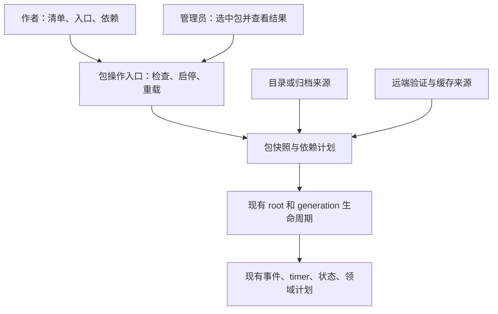

# 参考 KubeLoader：NekoJS 脚本包复杂度与改进评估

日期：2026-10-14。范围是脚本包及相关运行时设计，不是整个 NekoJS 的全面架构审计。

- NekoJS：`fe89c770d2d47efe1d3f72421328565eaf7dd889`，最新生产源码为 `f236a983b915023283b2baf200ddec4074844712`。
- KubeLoader：`WhiseNT/kubeloader` 的 `master` 在本次获取时为 `1f5222c049ccdb0fd256e1bace9385176a59c6ba`。只读副本位于 `build/research-kubeloader-20261014`，未执行外部构建或脚本。
- Luna xhigh 调查 KubeLoader 源码，主代理交叉核对关键实现并评估 NekoJS。详见 [KubeLoader 源码调查](2026-10-14-kubeloader-source.md)、[NekoJS 机制整理](2026-10-13-script-pack-improvement.md)。

## 1. 结论

**NekoJS 有可以收敛的设计复杂度，最明显的是包的行为缺少一个统一入口，发现、启用状态、执行、重载和同步的规则分散；这不等于签名、候选重载、跨版本适配本身都多余。**

当前 NekoJS 的基础包格式其实比较简单：目录加 manifest，按 Script Type 扫描文件。但运行时承担了更多保证，包本身却还没有完整的依赖、实例和生命周期契约。这导致“内部实现已经复杂，作者得到的包管理能力还不够完整”。这是本次基于调用链与用户操作得到的判断，不是用类数量或文件长度证明过度设计。

KubeLoader 可借鉴的重点是集中、连贯的 ContentPack 产品模型：来源收集 → 元数据和依赖检查 → 类型脚本包 → 资源挂载/分发工具。NekoJS 应吸收这种组织方式，保留自己的安全、线程和失败契约，逐步把复杂工作藏在少量稳定操作之后。

这轮不建议全面重写，也不建议直接把另一项目的 Context、共享 Map、Mixin 接线搬进来。

## 2. 比较必须先统一尺度

KubeLoader 是 KubeJS 附属模组，这个提交的构建配置针对 Minecraft 1.20.1 / Forge，依赖 KubeJS 2001.6.5，使用 Java 17。它复用了 KubeJS 的脚本、事件和资源机制，同时新增 Rhino/Graal 接线、源码转换、包生成、声明工具等。不能把附属项目的总代码量与独立引擎直接比较。[构建属性](https://github.com/WhiseNT/kubeloader/blob/1f5222c049ccdb0fd256e1bace9385176a59c6ba/gradle.properties#L4-L34)、[构建工具链](https://github.com/WhiseNT/kubeloader/blob/1f5222c049ccdb0fd256e1bace9385176a59c6ba/build.gradle#L10-L31)。

NekoJS 目前有五个版本/loader 节点，并有 TypeScript/Python 声明后端、限制宿主访问、root/generation 所有权、整类重载失败保留、远端签名缓存等要求。这些存在实际变化或实际契约，不能作为“只保留一个简单 loader”的等价替换对象。[节点矩阵](../../.github/workflows/ci-build.yml#L138)、[Probe 后端](../../common/src/main/java/com/tkisor/nekojs/core/plugin/ProbeBackendsPoint.java#L29)、[候选重载](../../common/src/main/java/com/tkisor/nekojs/script/ScriptManager.java#L817)、[远端授权与物理恢复](../../common/src/main/java/com/tkisor/nekojs/core/pack/sync/PackSyncClient.java#L296)。

所以，本次比较三项：作者要掌握的规则、调用者如何请求一次包操作、内部是否集中拥有这次操作的状态和失败处理。没有比较性能优劣或宣称某一项目的运行可靠性更高。

## 3. KubeLoader 中值得借鉴的事实

| 机制 | 当前源码支持的行为 | 对 NekoJS 的启发 |
|---|---|---|
| ContentPack / Provider | 同一 ContentPack 形状承接不同来源，Provider 区分缓存收集与重新收集 | 目录、未来归档、远端已验证缓存的差异留在来源实现中 |
| 包元数据 | 有包 ID、版本、依赖列表；依赖区分 PACK/MOD、版本范围与关系类型 | 包依赖应当成为明确的包契约，不能继续靠字母序或文件 after 暗示 |
| 依赖检查与排序 | 验证依赖条件，另行构建排序关系 | 缺依赖和加载顺序分别解释，给作者一个可查询执行计划 |
| namespace 对应 Graal Context | 正常注入路径按包 namespace 创建/关联 Context | 包作为运行实例有直观价值，NekoJS 需要为自己的线程/状态/重载契约验证这种粒度 |
| 创建与分发工具 | 源码包含目录、归档、已加载模组来源和生成工具 | “写好后如何安装和分享”应成为包体验的一部分 |

依据：[ContentPack](https://github.com/WhiseNT/kubeloader/blob/1f5222c049ccdb0fd256e1bace9385176a59c6ba/src/main/java/com/whisent/kubeloader/definition/ContentPack.java#L15-L37)、[Provider 收集](https://github.com/WhiseNT/kubeloader/blob/1f5222c049ccdb0fd256e1bace9385176a59c6ba/src/main/java/com/whisent/kubeloader/impl/ContentPackProviders.java#L14-L50)、[依赖描述](https://github.com/WhiseNT/kubeloader/blob/1f5222c049ccdb0fd256e1bace9385176a59c6ba/src/main/java/com/whisent/kubeloader/definition/meta/dependency/PackDependency.java#L17-L54)、[依赖检查](https://github.com/WhiseNT/kubeloader/blob/1f5222c049ccdb0fd256e1bace9385176a59c6ba/src/main/java/com/whisent/kubeloader/impl/depends/PackDependencyValidator.java#L29-L108)、[Context 管理](https://github.com/WhiseNT/kubeloader/blob/1f5222c049ccdb0fd256e1bace9385176a59c6ba/src/main/java/com/whisent/kubeloader/graal/GraalScriptManager.java#L11-L45)。分发工具和接线细节见子代理报告。

这里的版本范围采用 Maven ArtifactVersion/VersionRange，不能改写成已经支持 npm semver 求解、依赖自动下载或动态提供者重激活。包依赖描述也不等于业务服务的动态能力依赖。

另外，源码存在普通 Zip Adapter，但已标记 deprecated，默认 Provider 注册处将其注释掉；默认可用的目录包与已加载模组 JAR 不能泛称为“任意 ZIP 开箱即用”。生成 Forge 模组 JAR 和在线安装脚本归档也属于不同功能。[默认来源注册](https://github.com/WhiseNT/kubeloader/blob/1f5222c049ccdb0fd256e1bace9385176a59c6ba/src/main/java/com/whisent/kubeloader/Kubeloader.java#L94-L114)、[Zip Provider](https://github.com/WhiseNT/kubeloader/blob/1f5222c049ccdb0fd256e1bace9385176a59c6ba/src/main/java/com/whisent/kubeloader/impl/zip/ZipContentPackProvider.java#L17-L39)。

## 4. 哪些“更简单”意味着不同的保证

### Context 分开不等于权限分开

KubeLoader 的 Graal 路径确实有按 namespace 分开的 Context，但创建路径开启 `allowAllAccess`、无限制 host-class lookup 和 native access；宿主访问基于 HostAccess.ALL。NekoJS 不能用这种配置来简化自己的限制策略。这是访问契约差异，不是本轮认定另一个项目有安全事故。[GraalApi](https://github.com/WhiseNT/kubeloader/blob/1f5222c049ccdb0fd256e1bace9385176a59c6ba/src/main/java/com/whisent/kubeloader/graal/GraalApi.java#L235-L243)。

### 简单替换不等于失败保留

KubeLoader 的 `loadScriptPack` 在已有 namespace 时先关闭旧 Context，再创建新 Context。这条实际接线所用的方法没有提供 NekoJS 整类重载的“先验证候选，失败时健康旧代继续可用”保证。不能为减少状态机而直接移植这个顺序。[替换顺序](https://github.com/WhiseNT/kubeloader/blob/1f5222c049ccdb0fd256e1bace9385176a59c6ba/src/main/java/com/whisent/kubeloader/graal/GraalScriptManager.java#L28-L45)、[NekoJS 候选准备](../../common/src/main/java/com/tkisor/nekojs/script/ScriptManager.java#L817)。

### 共享 Map 不等于受管状态或服务生命周期

KubeLoader 的 ContentPacks Binding 提供元数据查询与 `putShared/getShared`。其底层是按 ScriptType 索引的静态 Map，允许显式读取其他类型。这是直接、易懂的作者入口，但不是包私有状态，也没有因包装成 Map 就得到候选写集、旧 Context 句柄失效或能力依赖的停启契约。[共享数据入口](https://github.com/WhiseNT/kubeloader/blob/1f5222c049ccdb0fd256e1bace9385176a59c6ba/src/main/java/com/whisent/kubeloader/plugin/ContentPacksBinding.java#L17-L112)。

建议借鉴它的查询便利性，保留 NekoJS 的受管 global/shared 行为。未来跨包提供服务时采用明确授权和激活身份，不把任意 guest Value 放进永久静态字典作为通用解决方案。

## 5. NekoJS 哪些复杂度需要保留

| 当前复杂度 | 保留理由 | 应怎样让调用者更省事 |
|---|---|---|
| root / generation 的生命周期区别 | 重载不能关闭共享插件产物、缓存 owner 等 root 资源 | 归属由内部创建/释放入口保证，不让每个调用者手动协调 |
| 候选准备、状态计划与提交 | 监听、timer、受管状态必须一致交接，失败保留健康旧代 | 由一次 reload 操作负责全过程，返回明确结果 |
| owner-thread 调度和 close 优先 | Graal/MC 操作有线程要求，过期候选不能在关闭后提交 | 提交请求即可，线程约束留在内部 |
| 签名、路径、远端授权与缓存恢复 | 远端内容和本地可信内容的规则不同；旧缓存不能回退成本地信任 | 已验证来源作为内部事实，不让作者自己传权限标志 |
| 平台来源与资源挂载差异 | 五节点、资源系统和声明后端实际不同 | common 保持独立，平台差异由已有 facade/节点实现承接 |

这些复杂度如果被删除，相同工作会重新散落到调用者，或者对外保证直接降低。它们应隐藏在小 Interface 后，而不是仅按“类太多”删除。[现有资源约束](../agents/coding.md#resources-threads-and-state)、[root 入口](../../common/src/main/java/com/tkisor/nekojs/core/lifecycle/NekoRuntimeRoot.java#L201)、[缓存保护](../../common/src/main/java/com/tkisor/nekojs/core/module/NekoRuntimeTrustContext.java#L29)。

## 6. 有证据的可简化位置

| 位置 | 本次核对到的具体事实 | 建议收敛方向 |
|---|---|---|
| 包操作分散 | 命令直接刷新 Registry、直接写 state；执行路径再次刷新；远端流程同时操作文件、Registry、root 授权、reload hook | 让一次包操作有一个内部 owner，已有 root 仍是总 owner |
| 状态与结果脱节 | state 保存失败只 WARN，命令仍显示成功；配置 enabled 与已扫描快照、实际活动代不是同一事实 | 统一“用户意图”和“当前活动结果”的查询，失败不报成功 |
| 多种重载语义 | 全量候选、单文件 active 重跑、STARTUP 不可逆回退，保证不同 | 一个结果模型说明执行方式和保证；内部保持必要差异 |
| 文件与包依赖混杂 | 扫描把支持脚本当入口，priority/after 排序文件；manifest 无包依赖字段 | 包描述明确入口、库和包依赖；模块 import 图继续属于代码层 |
| 来源 scope 与实例作用域 | GLOBAL/WORLD/SERVER_CACHE 表达来源；当前没有世界/会话能力实例 ID | 来源信息保持内部，实例身份按真实生命周期定义，避免多套 scope 让作者选 |
| 静态状态与 root 状态混合 | Registry、PackSyncClient 的当前会话和 reload hook 是 process-static；运行授权及 generation 又在 root 内 | 明确哪些按进程、连接或 root 存活，消除不必要的隐式上下文参数和 global callback 依赖 |

依据：[命令](../../src/main/java/com/tkisor/nekojs/command/NekoJSCommands.java#L244)、[state](../../common/src/main/java/com/tkisor/nekojs/core/pack/ScriptPackState.java#L41)、[发现刷新](../../common/src/main/java/com/tkisor/nekojs/script/ScriptManager.java#L600)、[单文件重跑](../../common/src/main/java/com/tkisor/nekojs/script/ScriptManager.java#L1272)、[远端流程](../../common/src/main/java/com/tkisor/nekojs/core/pack/sync/PackSyncClient.java#L316)、[静态会话字段](../../common/src/main/java/com/tkisor/nekojs/core/pack/sync/PackSyncClient.java#L52)。

这张表说明维护者需要跨模块掌握的规则和可观察结果，并未证明实际发生泄漏、竞态或所有 static 都应该移除。将稳定进程服务机械地搬进 root 也可能增加复杂度，需按真实存活范围处理。

## 7. 建议的收敛形状

建议复用现有实现，围绕包操作形成一个深模块：调用者表达“检查这个包、启用这个包、重载这个包”，模块内部负责身份、依赖、准备、权限、资源和结果。新名字和公开方法尚未确定；下图是职责设计，不是新增类清单。

关键限制：

1. **使用 `NekoRuntimeRoot` 作为总 owner。** 包操作职责放在它拥有的实现中，不增加第二套 runtime manager。
2. **来源可变，操作规则统一。** 目录与未来归档/已验证缓存可有内部 Adapter；来源 Adapter 不自行激活 Context。
3. **包的最小描述直接服务作者。** 先明确身份、版本、入口、依赖；不要把 generation、信任 credential、事务 phase 放进作者必填清单。
4. **依赖检查与动态能力协调分别负责各自规则。** 前者决定包是否满足版本/环境条件；后者解决运行中提供者出现、失效、恢复。不要混成一个万能 resolver。
5. **确定一个包操作的最终结果。** 格式验证、物理安装、运行激活和同步仍有内部阶段，调用者不应该凭几个布尔值猜测最终是否生效。
6. **按行为集中实现，避免加一层透传门面。** 如果新入口只逐个暴露当前 Registry、Cache、Trust、Context，复杂度没有减少。它应拥有跨这些步骤的流程与失败处理。

内部可继续保留专门的解析、验证、缓存和候选计划模块。收敛的是调用者必须协调的步骤，以及状态的最终拥有者；不是把所有类合并成一个大文件，也不是每个阶段再加一层通用接口。

## 8. 如何处理已有 Cordis 路线

现有 [Cordis reassessment](cordis-v4-reassessment.md) 记录 G1 动态能力、G2 作用域实例、G3 资源归属、G4 局部重载为维护者确认的目标。此次简化评估不撤销它们。

建议用脚本包作为首先落地的具体场景：包在某个 ScriptType/世界/会话中有激活实例，依赖服务变化驱动受影响包，资源按实例归属，更新准备闭合候选集合。这样既保留目标，也不用一开始向所有作者公开任意层级的作用域组合、通用资源图和复杂能力句柄。

该方案仍需支持明确的跨世界/会话实例隔离及后续扩展；“优先让包场景好用”不是永久用整类 reload 替代局部重载，也不是只交付资源清理就报告四项目标完成。多 Context、受限数据桥和 guest 对象寿命需要先做原型，不能因 KubeLoader 创建了多 Context 就假定 NekoJS 的状态与候选事务自动成立。

## 9. 建议的实施顺序与变化范围

| 阶段 | 加入/修改的内容 | 应减少的复杂度 | 验收关注 |
|---|---|---|---|
| 1. 统一行为与反馈 | 有来源的包身份、准确状态/执行计划、状态保存结果；整理命令和文档 | 同名含糊、是否已生效、错误显示成功 | 同名来源、写入失败、WORLD 生效时点、远端活动包查询 |
| 2. 明确包契约 | 严格的新描述版本、入口/库、依赖校验和排序，旧包语义保留 | 作者不再用文件顺序模拟包依赖 | 旧包兼容、坏字段、缺依赖/环/版本、执行次数 |
| 3. 包生命周期 | 复用 root 内调度，实例与资源 owner、动态能力协调、局部候选集合 | 一次修改不要求调用者协调多套启停路径 | 健康旧集合保留、消费者停启、旧句柄、跨世界/会话隔离 |
| 4. 安装与分享 | 在上述契约稳定后加入归档来源、构建/安装工具，接入已有签名缓存 | 复制目录和手动准备依赖的负担 | 可重复构建、完整内容、失败恢复、签名与平台资源生效 |

第 1 阶段可以较小；第 2–3 阶段是契约和运行时工作，不能包装成简单整理。归档支持涉及路径、内容摘要及签名，不应同时直接替换现有远端 wire。把脚本导出成可执行 JAR 模组也比单纯包归档增加 loader 生命周期、信任与兼容要求，当前没有足够理由优先引入整套模组生成器。

旧包、平铺目录、Script API、Plugin API、已有配置和持久化格式均需按明确迁移范围处理；本次不授权公开删除或发布。建议新包契约提供选择加入的迁移，不静默让旧包变成独立 Context/局部事务包。

## 10. 如何证明“变简单了”

不要用删了多少类作为通过条件。建议比较同一场景的使用与维护成本：

- 新建包：作者需要写多少必填信息，能否清楚区分入口和库。
- 安装依赖：错误是否一次说明目标、版本、来源和阻止激活的原因。
- 修改一个包：管理员是否能知道受影响包集合及各自理由。
- 候选失败：健康旧实例、监听和 timer 是否继续正确运行，无关包是否不重跑。
- 禁用/卸载：一次操作是否完成状态持久化、消费者处理和受管资源释放，并准确报告未释放资源。
- 维护实现：同一种规则是否有唯一拥有者，命令和网络接线是否只提交请求、读取结果。
- 性能：固定脚本、平台和精确 revision 测量初始化、重载和 Context 资源成本；不猜测“更多 Context 更快/更慢”。

文档与最小原型先解释这些行为；在最终实现收敛后集中运行适当单元/隔离/五节点及实机验证，遵守维护者既有测试节奏。

## 11. 本轮交付与限制

新增这份评估和 Luna 的源码调查，未修改实现、公开接口或原有设计文档。本轮检查引用、源码结论和文档一致性，不运行两个项目的构建、测试或游戏。

KubeLoader 的 README 是目标描述；本报告只将核对过的实现记为事实。依赖检查与 namespace Context 不表示已证明动态能力恢复、失败候选保留或通用资源清理。NekoJS 的当前性能/完整 IDE 等未完成验收继续保留其原有状态，本评估不构成修复或验收通过。
